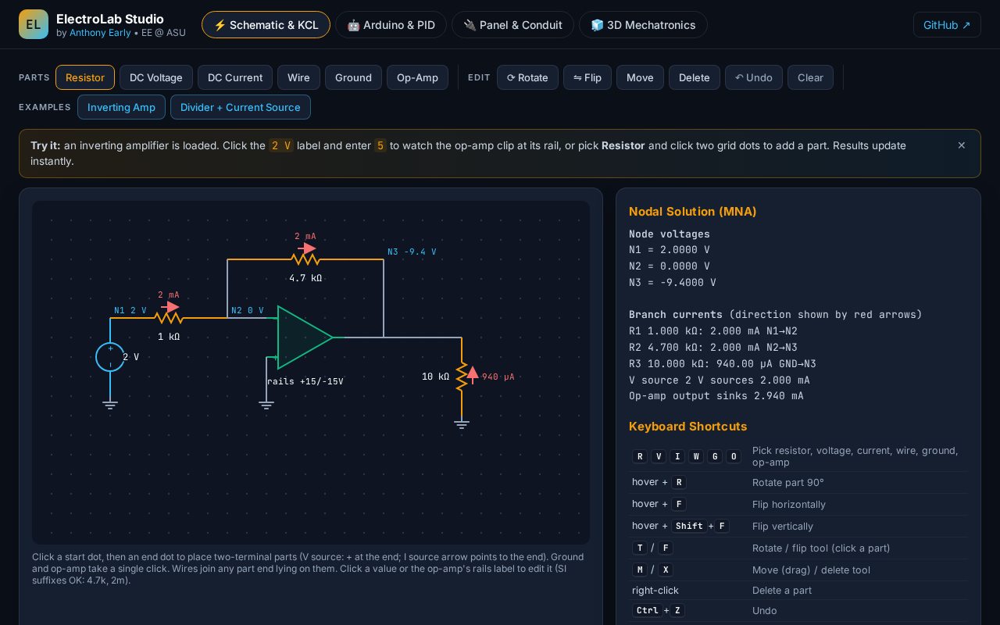

# ElectroLab Studio

Browser-based EE workbench by Anthony Early: schematic editor + DC nodal (MNA/KCL) solver with op-amps, Arduino/ESP32 pinout planner + PID simulator with .ino export, NEC-style panel schedule & conduit fill calculator, and a three.js 3D mechatronics viewer. Pure static HTML/CSS/JS.

Live: https://electrolab-mu.vercel.app

## Keyboard shortcuts (Schematic)
`R V I W G O` pick a part · hover + `R` rotate 90° · hover + `F` / `Shift+F` flip · `T` / `F` rotate/flip tools · `M` move · `X` delete · `Ctrl+Z` undo · `Esc` cancel.

## Tests
Playwright checks (Python): `python3 tests/qa_test.py <url> <out_dir>` (solver, rotate/flip, saturation, editing) and `python3 tests/polish_test.py <url>` (onboarding, layout, console errors, mobile overflow). QA screenshots live in `docs/qa/`.
